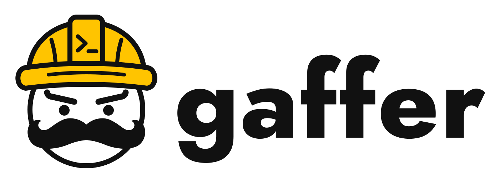

<p align="center">
  <picture>
    <source media="(prefers-color-scheme: dark)" srcset="logos/svg/gaffer-logo-dark.svg">
    <source media="(prefers-color-scheme: light)" srcset="logos/svg/gaffer-logo.svg">
    
  </picture>
</p>

<p align="center">
  <a href="https://github.com/mfullbrook/gaffer/actions/workflows/ci.yml"></a>
  <a href="LICENSE"></a>
  
  
</p>

gaffer turns one Linear issue into a reviewed pull request while you are away from the keyboard. Codex writes the tests, Claude writes the code, and a small local Python process (SQLite, no server, no inbound network) runs the job and does all the waiting.

It runs only on your Claude and ChatGPT subscriptions, through the `claude` and `codex` CLIs. It never uses API keys: preflight refuses to start if it finds one, or if either CLI is logged in any other way.

Status: v0.1, run from this repository with `uv run gaffer`. `gaffer doctor` and `gaffer eval` have run live. The full `gaffer run` against a real Linear issue and GitHub repo (the toy-repo demo, SC2 in the design) has not been demonstrated yet.

## How a job runs

```text
gaffer run ENG-123
  PREFLIGHT   subscription logins, isolated config dirs, no API keys, gitleaks present;
              reruns `gaffer doctor` if a CLI version changed
  INTAKE      read the Linear issue (read-only); it needs an "Acceptance criteria"
              heading or a checklist
  WORKSPACE   clone your checkout into the job dir, branch gaffer/ENG-123, record the base SHA
  TESTER      Codex writes blind tests against the unchanged repo
  RED-FIRST   gaffer runs them on the base; acceptance tests must fail for the right reason;
              they become the branch's first commit
  WRITER      Claude implements and commits locally (no push, no network beyond registries)
  VERIFY      gaffer runs the tests itself on the exact head; failures go back to the writer
  PUBLISH     gitleaks scan, push (never force), open the PR ready for review
  ROUND       no AI running: poll required checks and CodeRabbit; one Codex review per head
  PACKET      new CodeRabbit findings, failed checks and Codex findings, deduplicated
  RESUME      the same Claude session addresses the packet, then VERIFY and PUBLISH again
  READY / BLOCKED / CLOSED, with a report
```

The writer never grades its own work: Codex defines success before Claude starts, and gaffer's own test run decides whether it was met. A job gets 3 repair cycles (local VERIFY repairs and review packets share the budget). gaffer stops at READY; merging is yours.

## Prerequisites

### Machine and tools

- macOS. The sandboxes are macOS Seatbelt.
- Python 3.14 and [uv](https://docs.astral.sh/uv/).
- Claude Code (`claude`) and the Codex CLI (`codex`).
- gitleaks (R15). gaffer scans every push, PR comment and packet with it, and refuses to run without it:

  ```sh
  brew install gitleaks
  ```

- Node.js, for sandbox-runtime.

Children get a fixed `PATH`: `~/.local/bin`, `~/.bun/bin`, `/opt/homebrew/bin`, `/usr/bin`, `/bin`, `/usr/sbin`, `/sbin`. `claude`, `codex`, `gitleaks` and `node` must be found there, not only on your shell's `PATH`.

### sandbox-runtime

Dependency installs (`install_command`) run under Anthropic's sandbox-runtime, pinned at 0.0.79 and installed in `~/.gaffer/tools/sandbox-runtime`. `gaffer doctor` always probes it, so install it even if no repo has an `install_command`. This is the command preflight prints:

```sh
mkdir -p ~/.gaffer/tools/sandbox-runtime
cd ~/.gaffer/tools/sandbox-runtime
npm install --ignore-scripts --save-exact @anthropic-ai/sandbox-runtime@0.0.79
```

### One-time logins into gaffer's own config dirs

Children never use your `~/.claude` or `~/.codex`. They run with `CLAUDE_CONFIG_DIR=~/.gaffer/claude` and `CODEX_HOME=~/.gaffer/codex`, and logins don't carry over (R3). Log each CLI in once, to the subscription:

```sh
mkdir -p ~/.gaffer/claude ~/.gaffer/codex
chmod 700 ~/.gaffer
CLAUDE_CONFIG_DIR=~/.gaffer/claude claude auth login --claudeai
CODEX_HOME=~/.gaffer/codex codex login --device-auth
```

Preflight then requires `claude auth status --json` to report `loggedIn: true`, `authMethod: "claude.ai"` and `apiProvider: "firstParty"`, and `codex login status` to print exactly `Logged in using ChatGPT` (R2). Both CLIs store these credentials as plain files inside `~/.gaffer`, which is why every child is denied `~/.gaffer`.

Also turn off paid overage ("extra usage") on both subscriptions, so a limit stops the job instead of billing you.

### Tokens in the Keychain

gaffer reads its own tokens from the login Keychain, service `gaffer`. They are never in a file, a log or a child's environment. Each command prompts for the value:

```sh
security add-generic-password -U -s gaffer -a github-token -w
security add-generic-password -U -s gaffer -a linear-token -w
```

- `github-token`: a GitHub token for the account named in `operator_login`. gaffer pushes the branch, opens the PR, reads reviews, review comments, check runs, annotations, commit statuses and Actions job logs, and posts one summary comment per round. For a fine-grained token on the repos gaffer works on, that means Contents read and write, Pull requests read and write, Checks read, Commit statuses read and Actions read.
- `linear-token`: a Linear personal API key. Read access is enough; v0.1 only reads issues and never writes back to Linear.

The first time gaffer reads an item, macOS may ask for access; choose Always Allow so an overnight run doesn't stall on the prompt.

### PHP repos

PHP repos use Laravel Herd's `php` and `composer` from `~/Library/Application Support/Herd/bin` (R29). Preflight refuses a PHP repo if either is missing.

### CodeRabbit

Install the CodeRabbit GitHub app on each repo. gaffer treats a round as complete when CodeRabbit's commit status says `Review completed`. If CodeRabbit never starts on a head (10 minutes by default), skips it or is paused, the round completes with CodeRabbit marked **unverified**, and the READY report says so.

## Configuration

gaffer reads `~/.gaffer/gaffer.toml`. Repos are keyed by Linear team key: `ENG-123` uses `[repos.ENG]`. Every problem is reported at once, with a fix, and an invalid config exits 4.

A minimal config:

<!-- config-example -->
```toml
operator_login = "your-github-login"  # the account the GitHub token belongs to
vault_path = "~/Documents/Vault"      # must exist; denied to every child
job_root = "~/gaffer-jobs"            # default; job clones live here
writer_model = "opus"                 # default; passed to claude --model
# codex_model = "..."                 # optional; unset uses the Codex CLI default

[repos.ENG]
path = "~/code/my-app"                # your local checkout
github = "owner/my-app"
base = "main"
ecosystems = ["python"]               # any of "python", "node", "php"
runner = "pytest"                     # "pytest", "jest", "vitest", "phpunit" or "generic"
test_command = ".venv/bin/python -m pytest -q -p no:cacheprovider --continue-on-collection-errors --junitxml=junit.xml"
junit_path = "junit.xml"
test_dirs = ["tests"]                 # where the tester may write
install_command = "sh scripts/install.sh"
required_checks = ["test"]            # CI check names that must pass
```

Global fields:

| Field | Default | Notes |
|---|---|---|
| `operator_login` | required | Your GitHub login. Your PR comments are admitted as feedback; gaffer's own round comments are excluded. |
| `vault_path` | required | Must exist. gaffer.toml may not live inside it. |
| `job_root` | `~/gaffer-jobs` | Must not overlap any denied path. |
| `writer_model` | `"opus"` | |
| `codex_model` | CLI default | Passed to Codex as `-m`. |
| `allowed_mcp` | `[]` | MCP server names passed to the writer. Definitions go in `~/.gaffer/mcp.json` as `{"mcpServers": {...}}`. Linear and claude.ai connector names are always refused. |
| `allowed_skills` | `[]` | Parsed, but has no effect in v0.1 (see Security). |

Repo fields:

| Field | Default | Notes |
|---|---|---|
| `path`, `github`, `base` | required | `path` must be a git checkout; `github` is `owner/repo`. |
| `ecosystems` | required | Sets the network allowlist and the harness files. |
| `runner`, `test_command`, `junit_path` | required | `test_command` must write JUnit XML to `junit_path`. |
| `test_dirs` | required | Repo-relative directories for tester files. |
| `required_checks` | `[]` | An empty list is refused unless `allow_no_ci = true`, which stamps NO CI EVIDENCE on every READY report. |
| `skippable_checks` | `[]` | Required checks for which skipped or neutral counts as a pass. |
| `install_command` | none | Runs under sandbox-runtime in the job clone and each verification worktree. |
| `extra_hosts` | `[]` | Extra registry hosts. GitHub hosts are refused. |
| `harness_paths`, `forbidden_paths` | `[]` | Globs added to the built-in lists; they can't remove defaults. |
| `test_timeout` | 900 | Seconds. |
| `round_timeout` | 1800 | Supervised seconds a review round may take. |
| `check_appear_timeout` | 600 | Seconds for a required check to appear after a push. |
| `coderabbit_appear_timeout` | 600 | Seconds for CodeRabbit to start after a push. |

Things gaffer needs from `test_command` and `install_command` but doesn't check in the config:

- Runner flags: pytest needs `--continue-on-collection-errors`, Jest needs `--no-watchman`, PHPUnit needs `--log-junit` and `--do-not-cache-result`. gaffer sets jest-junit's environment itself.
- Tests run with no network and can write only inside the job dir, so `test_command` must not install or download anything. Use the venv's Python directly rather than `uv run`.
- Installs can write only inside the job dir and `$TMPDIR` points there. Keep tool caches under it, as `evals/toy/scripts/install.sh` does with `UV_CACHE_DIR`.

## Usage

Run every command from a checkout of this repository.

### `gaffer run <ISSUE>`

```sh
uv run gaffer run ENG-123
```

Runs or continues the job for one issue. gaffer runs one job at a time. Rerunning the same command after a crash, a restart or a fixed BLOCKED cause picks up where the job stopped, without a second PR, writer or comment. A READY rerun reprints the report.

| Flag | Use |
|---|---|
| `--more-cycles N` | Grant N more repair cycles, for example after `verify_failed` or `repair_limit`. Grants are recorded and add up. |
| `--continue` | After READY, process feedback that arrived later. |
| `--fresh` | After CLOSED, archive the job and start a new one on `gaffer/ENG-123-2`. |
| `--adopt-head` | After `foreign_head` or `base_conflict`, accept the PR's current remote head and recompute the base as the merge-base. |

`--adopt-head` does **not** rebuild a job after `state_lost` (`~/.gaffer/state.db` lost while the branch or PR exists). That reconstruction isn't built (R9, R23); gaffer refuses and tells you to close the PR and use `--fresh`, or restore `state.db`.

Exit codes:

| Code | Meaning |
|---|---|
| 0 | READY |
| 1 | Internal error (including a failed Linear fetch) |
| 2 | BLOCKED, with a reason code and a fix in the report |
| 3 | CLOSED: the PR was closed or merged by someone else |
| 4 | Refused: invalid config or arguments, an issue whose team has no `[repos.<TEAM>]`, a missing Keychain token, preflight or doctor failed, a lock is held, a child from an earlier run is still alive, or another job is still active |

### `gaffer doctor`

```sh
uv run gaffer doctor
uv run gaffer doctor --config PATH
```

Probes every isolation control on the installed CLIs: logins, config isolation, and read, write and network limits for the Claude writer sandbox, Codex children, the test sandbox and sandbox-runtime (22 probes, about a minute). Without `~/.gaffer/gaffer.toml` and without `--config`, it probes built-in defaults with a stand-in vault. Exit 0 on a pass, 4 on any failure. It spends a little quota: one short `claude -p` on haiku and one `codex exec`.

`gaffer run` reruns doctor automatically when the Claude Code, Codex or pinned sandbox-runtime version differs from the last pass, or when the deny list changed, and refuses if it fails (R18).

### `gaffer eval`

```sh
uv run gaffer eval
uv run gaffer eval --save-baseline
uv run gaffer eval --promote RUN_ID
```

Runs three toy tickets (`evals/`) through the real prompts and children locally, with no push, PR, CodeRabbit or Linear, and compares the result with the stored baseline. **Run it before merging any change under `prompts/`** (R19), and never in CI. It uses subscription quota.

- The first complete run becomes the baseline.
- `--save-baseline` stores this run as the new baseline, unless it has regressions.
- `--promote RUN_ID` makes an earlier complete run the baseline without running anything.
- `--config PATH` picks the gaffer.toml for models, vault and MCP; its repos aren't used.

Exit codes: 0 no regression or baseline stored, 1 internal error, 2 regression (or `--save-baseline` refused), 3 incomplete (a usage limit or error stopped the run), 4 refused.

### Where things live

| Path | Contents |
|---|---|
| `~/.gaffer/gaffer.toml` | Config. |
| `~/.gaffer/state.db` | SQLite: jobs, attempts, rounds, feedback items, packets, doctor runs. |
| `~/.gaffer/jobs/<job>/report.md` | The job report: PR, heads, criterion to test map, dispositions, CodeRabbit verified or not, usage per attempt. |
| `~/.gaffer/jobs/<job>/logs/` | Child transcripts (`writer-*.jsonl`, tester and reviewer `*.jsonl`) and `test-*.log`, `install-*.log`. |
| `~/.gaffer/jobs/<KEY>.lock`, `~/.gaffer/run.lock` | Locks held while gaffer runs. |
| `~/.gaffer/claude`, `~/.gaffer/codex` | gaffer's CLI logins and session files. |
| `~/.gaffer/evals/` | Eval runs and `baseline.json`. |
| `<job_root>/<job>/` | The job dir: the job clone (`repo/`), verification worktrees and temp files. The only place children can write. |

`<job>` is the issue key, or `ENG-123.2` after `--fresh`.

### Stopping a job

There is no `gaffer stop` yet (a P2 TODO). Children run in their own process groups, so Ctrl-C on gaffer doesn't stop a running child, and a rerun refuses while a recorded child is still alive. To abort, kill the child's process group by hand, then rerun.

## Keep the Mac awake

gaffer doesn't prevent sleep (R16). If the Mac sleeps, polling and any running child pause until it wakes. Round deadlines count only supervised time, so a sleep doesn't time out a round, and sleeps over 2 minutes are noted in the job log and report (R25). But nothing happens while the Mac sleeps, so a run started at night can sit idle until morning.

Set the Mac to never sleep while gaffer runs. On a Mac mini, turn on "Prevent automatic sleeping when the display is off" in System Settings > Energy, or from a terminal:

```sh
sudo pmset -a sleep 0
pmset -g | grep -w sleep
```

The display can still sleep. On a laptop, keep it on power. For a single run you can also wrap the command, which holds a sleep assertion until gaffer exits:

```sh
caffeinate -i -s uv run gaffer run ENG-123
```

## Security model and residual risks

Issue text, repository files and review comments are untrusted. The design assumes a child can be prompt-injected and limits what that child can reach. This section says what is enforced and what isn't (R1).

### What is enforced

- **No tokens in children.** Each child gets an environment built from an allowlist (`HOME`, `PATH`, `USER`, `TMPDIR`, `LANG`, `TERM`, the two config dirs, plus fixed per-role settings). No API keys, base URLs, provider switches, or GitHub or Linear tokens. Children never push, comment or call GitHub; gaffer does, with its own Keychain token.
- **Claude writer.** Claude Code's sandbox runs every Bash command with writes limited to the job dir, reads denied on the deny list, and network limited to the repo's registry hosts. The file tools (Read, Edit, Write) are outside that sandbox; Read is blocked by permission deny rules for every deny-list entry, and writes outside the job dir rely on Claude Code's `acceptEdits` mode refusing paths outside the working directory. WebFetch, WebSearch, hooks, plugins, bundled skills, and Linear and claude.ai connector tools are off. gaffer checks each child's init event and kills it if a plugin or an unlisted MCP server loaded.
- **Codex tester and reviewer.** Named Codex permission profiles: read-only, deny list unreadable, no network. AGENTS.md and the Codex extras (plugins, apps, hooks, multi-agent, browser and others) are disabled.
- **gaffer's test runs.** Run under the Codex sandbox: writes only in the job dir, deny list unreadable, no network.
- **Dependency installs.** Run under sandbox-runtime with the same write and read limits and network limited to the registry hosts.
- **Network allowlist.** python: `pypi.org`, `files.pythonhosted.org`. node: `registry.npmjs.org`. php: `repo.packagist.org`, `packagist.org`, `api.github.com`, `codeload.github.com`. Plus each repo's `extra_hosts`. `github.com` is never allowed.
- **Deny list.** `~/.ssh`, `~/.config/gh`, `~/.aws`, `~/Library/Keychains`, `~/.claude`, `~/.codex`, `~/.gaffer`, `~/.claude.json`, `~/.composer`, `~/.config/composer`, `~/Library/Application Support/Herd/config/valet`, and your `vault_path`.
- **gitleaks before anything leaves.** Every push diff, PR comment and packet item is scanned; a hit is BLOCKED: secret_detected with the finding redacted. If gitleaks itself fails, nothing is published.
- **Commit gates.** gaffer checks every writer commit before publishing: no commits to `.claude/`, `.codex/` or `.mcp.json`; changes to tester tests, test harness, manifests, lockfiles or CI workflows need a `Tester-Change-Reason:` line and are listed in the report; the tester's commit must stay in history; never a force push.
- **Git hardening.** The job clone's `.git` is writable by the writer, so gaffer runs its own git commands with system and global config, hooks, fsmonitor and credential helpers disabled, and restores its known-good `.git/config` before each one.
- **Re-verification.** `gaffer doctor` re-probes all of the above when a CLI or the sandbox-runtime pin changes. CLI updates are frequent: Claude Code went from 2.1.295 to 2.1.304 in four days during the spike.

### What is not enforced

- **Children can read anything not on the deny list.** Other files in your home directory, other repos, and anything else readable by your user are visible to the writer, the tester, the reviewer and code run by tests or installs. They can't send it anywhere except a registry host or, for PHP repos, the GitHub REST API (next point), and anything pushed passes gitleaks. Keep secrets on the deny list or out of your home directory.
- **PHP repos open the GitHub API.** `api.github.com` is allowlisted for Composer downloads, so sandboxed code in a PHP repo can reach the whole GitHub REST API, though it has no GitHub token (accepted in R29).
- **Registry hosts are two-way.** Code that can reach PyPI, npm or Packagist could also publish to them with a credential it finds outside the deny list.
- **Skills.** Account-synced Claude skills load in the writer and are listed in the report (accepted, R28). Codex children can see skills in `~/.agents/skills`, because `CODEX_HOME` doesn't isolate them (accepted, R28). `allowed_skills` in gaffer.toml has no effect, and `gaffer sync-skills` doesn't exist.
- **MCP servers in `allowed_mcp` run outside the sandbox.** The report lists them. Doctor doesn't exercise them.
- **CI workflow edits run with the repo's secrets.** The writer may change `.github/workflows/**` with a reason; once CI runs on the PR, that workflow runs with the repo's Actions secrets. The report lists every such change (accepted, R30).
- **Prompts are visible to `ps`.** Issue text and prompts are passed to the CLIs as arguments.
- **gitleaks is a pattern scanner.** It misses secrets it has no rule for.

### Known gaps in v0.1

- GitHub rate-limit headers aren't honoured; the client has no rate-limit handling.
- `gaffer stop` doesn't exist (see Stopping a job).
- `--adopt-head` can't rebuild a job after `state_lost` (R23 is unresolved).
- `test_command` runner flags aren't validated from the config; a missing flag shows up as a failed run.
- The writer's environment doesn't set a uv cache directory, so `uv` in a repo with no guidance about it may fail on `~/.cache/uv`.
- The install environment gaffer prepares for verification worktrees (for example `npm_config_cache`) is dropped before sandbox-runtime runs.
- Running `--more-cycles N` again after a crash grants the cycles twice; both grants show in the report.
- Vitest output is tested only against fixtures built from its docs; Jest and Vitest `xfail`-style tests can't be detected.
- No Linear write-back: BLOCKED and READY are reported on the terminal and in `report.md` only.

## Development

```sh
uv run pytest
```

The suite has 1086 tests and takes about 10 to 14 minutes. It runs on fakes, recorded CLI transcripts, captured CodeRabbit fixtures and disposable git repos, and needs no logins or tokens. Tests that need the real gitleaks binary are skipped if it isn't installed.

- `src/gaffer/`: `config.py`, `children.py` (preflight and every child launch), `store.py`, `workspace.py`, `reviews/`, `runner.py` (CLI and state machine), `doctor.py`, `prompt_eval.py`.
- `prompts/`: the tester, implement, review and address prompts. Run `gaffer eval` before merging a change here.
- `evals/`: the toy repo and three tickets used by `gaffer eval`.
- `docs/designs/gaffer-overnight-pair.md`: the design and its decision ledger (R1 to R34). It is the source of truth; where records conflict, the later one wins.
- `docs/experiments/`: Experiment 1 (billing route) and Experiment 2 (CodeRabbit).
- `docs/spike-results.md`: Experiment 3, the vertical spike that proved the sandbox and login setup, and 3b for PHP.
- `docs/t*-report.md`, `docs/r3*-report.md`: one report per task or amendment, each with its open issues.
- `spike/`, `experiments/`: throwaway scripts behind those results.
- `logos/`: the logo. `logos/build_logo.py` regenerates the SVGs and PNG previews.

## Contributing

Issues and pull requests are welcome. See [CONTRIBUTING.md](CONTRIBUTING.md), and report security problems privately as described in [SECURITY.md](SECURITY.md). This project follows a [code of conduct](CODE_OF_CONDUCT.md).

## License

[MIT](LICENSE)
